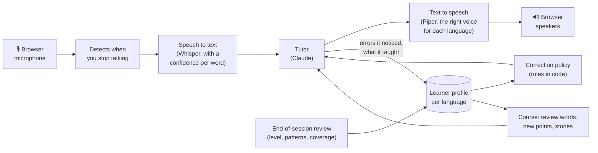

# FARIA

[](https://github.com/bazholifield/faria/actions/workflows/tests.yml)

**An AI language tutor you talk to out loud.** It holds a conversation in the language you're
learning, at your level, corrects you the way a good teacher does, mostly without stopping the
conversation, and remembers how you're doing between sessions.

<!-- DEMO VIDEO: a 2–3 minute screen recording of a voice session goes here (a language switch,
a correction or two, and the summary at the end). Upload the .mp4 by dragging it into a GitHub
issue or the README editor, and paste the link it gives you on its own line. -->

As an English teacher, I believe what most learners are missing is someone patient to talk to who knows their
level and notices their mistakes without turning each one into an intensive lesson. FARIA is designed to be
conversation partner. The name from Abbé Faria, the prisoner in *The Count of Monte Cristo* who
teaches Edmond Dantès languages and history in prison.

## What it does

- **Talks with you** by voice in the browser (English, Spanish, French, German, Arabic) or by text
  in the terminal (any language Claude speaks).
- **Follows your subject.** It asks what's on your mind and teaches inside whatever you bring.
  When you have nothing in mind, it tells you something from the history, art or literature of
  the places the language is spoken, instead of making small talk.
- **Takes instructions in conversation.** "Switch to German", "correct me less" and "slower,
  please" are things you say, and they're remembered.
- **Keeps a profile per language:** a level estimate, recurring mistakes, words under review, and
  what you've covered of a syllabus (Spanish, French, German, A1 to B2).

## The linguistics

Most of the design decisions are about language teaching. Each is written up, with what went wrong
first, in [DECISIONS.md](DECISIONS.md).

**Recasts by default.** FARIA corrects by repeating what you meant, correctly, inside its reply:
*"Yo voy a la playa ayer"* gets *"Ah, ¿fuiste a la playa ayer? ¿Qué tal?"* How often it corrects and
how explicitly are separate settings. The model phrases corrections well but decides *when* to
correct inconsistently, so that decision is deterministic code (`domain/correction.py`): budgets
per turn, severity thresholds, escalation for repeated mistakes, each rule tested.

**Making recasts noticeable.** Learners often miss a recast because it sounds like an ordinary
question. In voice, FARIA stresses the corrected word the way a teacher does: a short pause, then
the word said slower (and shown in bold).

**Spelling never counts in speech.** Spelling, accents and punctuation are never corrected, even
in typed sessions, except where an accent carries grammar: *"ayer hablo con ella"* for *habló* is a
tense error and is treated as one.

**The transcript is a witness, not a fact.** Speech recognition mishears, and early on FARIA would
"correct" things I never said. Every word now carries the recognizer's confidence; an error on an
uncertain word is logged but never corrected or counted, and an absurd sentence gets "what did you
mean?" rather than a correction.

**Countable errors.** Six fixed categories with closed subcategories and a 1–4 severity scale with
written anchors (slip, minor, disruptive, breakdown), for the same reason annotators share a
guideline: free-text labels can't be counted across sessions. A mistake that keeps recurring
becomes a *pattern* and gets more attention.

**Level as evidence.** Learners are rarely one level across the board, so FARIA estimates CEFR
separately for vocabulary range, accuracy, complexity and comprehension, and keeps every
observation so the estimate can be recomputed.

**A course that doesn't feel like one.** Each session the mentor is offered words due for spaced
review (Leitner boxes, 1 to 30 days), a new point or two at your level, and stories, as ideas, not
an agenda. Review happens through use in conversation. A new language starts with a placement
conversation that gets gradually harder without announcing a test.

**Varieties and pace.** Spanish is neutral Latin American by default, with Spain's *vosotros* and
Argentina's *vos* taught as variants; the voice is Spain's, with Mexican and Argentine voices one
config line away. Beginners get longer to finish a thought (1.1 s of silence
at A1, 0.6 s at C2) and slower speech. A phrase in another language mid-sentence gets that
language's voice, but only when the phrase is clearly foreign, after a real session read two
ordinary Spanish words (*me contaste*) in the English voice.

## How it works



Claude writes the replies and reports, through structured tool calls, the errors it noticed and
what it taught, so both can be stored and counted. After each session a cheaper model rereads the
transcript to catch missed errors and update the level estimate. Whisper and Piper run locally;
OpenAI speech is optional.

## Where it stands

It works end to end in text and voice, and I've used it for about 20 sessions. Latency was about
4.5 s from the end of my sentence to the first word of the reply in July, on a CPU-only laptop;
prompt caching, early transcription and an instant acknowledgement have gone in since, and the
target is under 2 s. A Claude exchange costs about half a cent to a cent. The syllabus and its
stories are drafts I'm checking item by item. Error-detection accuracy and level-estimate
validity aren't measured yet; that's next on the [roadmap](ROADMAP.md).

## Running it

Python 3.11+ and an [Anthropic API key](https://console.anthropic.com/):

```bash
python3 -m venv .venv && source .venv/bin/activate
pip install -e ".[dev]"
echo "ANTHROPIC_API_KEY=sk-ant-..." > .env   # your key; .env is gitignored
faria chat --language es      # text; /end for a summary
faria serve                   # voice at http://localhost:8765 (first run downloads ~560 MB of models)
faria patterns --language es  # your recurring mistakes
faria dev                     # developer console: run ledger and prompt lab
pytest                        # no key needed
```

Optional in `.env`: `OPENAI_API_KEY` (OpenAI speech), `FARIA_DATA_DIR` and `FARIA_CONFIG` (other
data or config locations). Settings are in `config/default.toml`, the tutor's persona in
`src/faria/tutor/prompt_text/personas/mentor.md`, and the syllabus in `curriculum/*.yaml`.

**Licence:** [PolyForm Noncommercial 1.0.0](LICENSE.md): free to use, study and change for any
noncommercial purpose.
