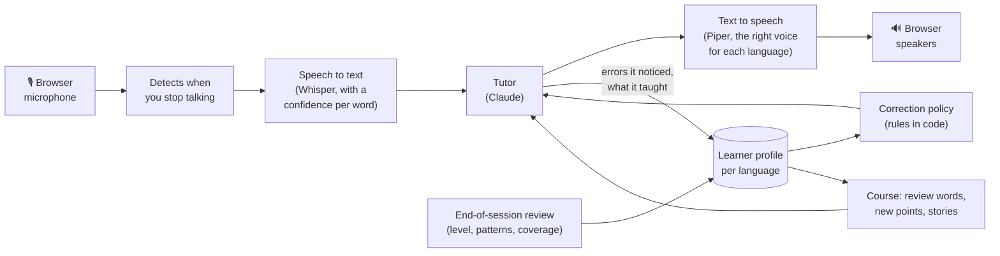

# FARIA

**An AI language tutor you talk to out loud.** It holds a conversation with you in the language
you're learning, at your level, corrects you the way a good teacher does (mostly without stopping
the conversation), and remembers how you're doing from one session to the next.

<!-- DEMO VIDEO: a 2–3 minute screen recording of a voice session goes here (a language switch,
a correction or two, and the summary at the end). Upload the .mp4 by dragging it into a GitHub
issue or the README editor, and paste the link it gives you on its own line. -->

I teach English in Spain, and I've learned that what most learners need isn't another grammar
exercise. They need someone patient to talk to who knows their level, notices their mistakes,
and doesn't turn every mistake into a lesson. That's hard to find outside a classroom, so I
started building it. The name comes from Abbé Faria, the prisoner in *The Count of Monte Cristo*
who teaches Edmond Dantès languages, history and science from the cell next door.

## What a session looks like

The picture I'm building toward: it's a weekend afternoon, I'm building furniture, and I turn
FARIA on. It keeps me company in English, with tips for what I'm doing, stories, and questions
(but never an interrogation). I say "switch to German" and it does, knowing my German level and
staying on the topic. Later, unannounced, it switches to French to test me and I have to keep
up. Eventually I ask for English back and some feedback on how I did.

## What it does

- **Talks with you** by voice in the browser, or by text in the terminal. Voice works today in
  English, Spanish, French, German and Arabic; text works in any language Claude speaks.
- **Takes instructions in conversation.** "Switch to German", "correct me less", "slower,
  please" and "teach me about the Basque Country" are things you say, not settings you click,
  and they're remembered.
- **Corrects you by a policy you control**: how often, and in what style.
- **Keeps a profile per language**: a level estimate, the mistakes you keep making, the words
  you're reviewing, and what you've covered.
- **Suggests what to learn next** from a syllabus (Spanish, French and German, A1 to B2: about 300
  grammar points, everyday tasks and vocabulary themes) and tells short stories about the
  culture and history, without turning the conversation into a lesson.

## The linguistics

Most of the interesting decisions in FARIA are about language teaching, not code. Each one is
written up in [DECISIONS.md](DECISIONS.md) with what I tried, what went wrong and why I chose what
I did. The main ones:

**Correcting without interrupting.** By default FARIA corrects with a *recast*: it repeats what
you meant, correctly, as part of its reply, the way a teacher or parent does. If you say *"Yo voy
a la playa ayer"*, it answers *"Ah, ¿fuiste a la playa ayer? ¿Qué tal?"* and the conversation keeps
going. How often it corrects (never, minimal, balanced, a lot) and how (recast, recast plus a short
note, or explicit) are two separate settings. Early on I noticed the model was good at *phrasing*
a correction but inconsistent about *deciding* when to correct, so that decision lives in code
(`domain/correction.py`): budgets per turn, which errors are serious enough to mention, and when
a repeated mistake earns more attention. Each rule has its own test.

**Making a recast noticeable.** The weakness of recasts is that learners often don't notice them:
*"¿Fuiste a la playa?"* just sounds like a friendly question. Teachers handle this by leaning on
the corrected word, so in voice sessions FARIA does too: a short pause, then the corrected word
said a little slower (and shown in bold).

**Spelling never counts in conversation.** FARIA is meant to be spoken, so spelling, accents and
punctuation are never corrected, even when you type. The exception is an accent that changes the
grammar: *"ayer hablo con ella"* (for *habló*) is a tense mistake that happens to show up as a
missing accent, so it's treated as one.

**Not correcting what the speech recognizer misheard.** In early voice sessions, the speech-to-text
model would mishear me and FARIA would confidently "correct" something I never said. Now every
word comes with the recognizer's confidence, and any error involving a word it wasn't sure about
is logged but never corrected or counted against you. If something sounds absurd, FARIA asks what
you meant instead of correcting it.

**Mistakes that can be counted.** Errors are labeled with a fixed set of 6 categories and their
subcategories, plus a 1–4 severity scale with a written description for each level (slip, minor,
disruptive, breakdown). A fixed set matters: free-text labels like "wrong verb" and "verb error"
can't be counted across sessions, the same reason human annotators work from a shared guideline.
When the same specific mistake keeps coming back (say, adjective gender agreement), it becomes a
*pattern*, and patterns that persist get more attention.

**Level as evidence, not a single number.** Learners are rarely one level across the board (you
might understand at B1 but speak at A2), so FARIA estimates a CEFR level for vocabulary range,
grammatical accuracy, sentence complexity and comprehension separately. Every observation is
kept, so the estimate can be recalculated if I change how it's computed.

**A course that doesn't feel like one.** The syllabus is a list of ideas, never an agenda. Each
session, FARIA gets a few suggestions: words due for review, one or two new points at your level,
and a couple of stories it hasn't told you yet. It decides whether they fit the conversation, and
you decide where the conversation goes. Review is spaced (a word you use correctly comes back after
longer and longer gaps, from 1 to 30 days), but it happens in conversation, not with flashcards. A
new language starts with a placement conversation that gets gradually harder, without ever
announcing a test.

**One variety, with the others as color.** For Spanish, FARIA speaks neutral Latin American Spanish
by default, and teaches Spain's *vosotros* and Argentina's *vos* as variants to recognize and
enjoy.

**Speaking at the learner's pace.** Beginners need longer to finish a thought, so FARIA waits longer
before deciding you're done (1.1 seconds of silence at A1, 0.6 at C2) and speaks a little slower to
lower levels. It says a quick "Mm-hm" while it thinks, and you can interrupt it mid-sentence.

## How it works



The browser only handles the microphone and speakers; everything else runs in a Python backend.
Claude writes the replies, and alongside each reply it reports the errors it noticed and what it
taught, through structured tool calls rather than free text, so they can be stored and counted.
After each session, a second, cheaper model reads the whole transcript again to catch errors the
live conversation missed and to update the level estimate. Speech recognition (Whisper) and the
voices (Piper) run locally for free; there's an optional OpenAI path for both.

## Where it stands

FARIA works end to end, and I've used it for about 20 sessions in text and voice. The newest
parts (the course layer, and the October changes to speech: acknowledgements, patience by level,
interruptions, stressed recasts) are built and tested but haven't had much real use yet.

- **Speed:** in July, on my CPU-only laptop, it took about 4.5 seconds from the end of my sentence
  to the first word of the reply (2.0 s speech recognition, 1.9 s for Claude to start, 0.5 s for
  the voice). The goal is under 2 seconds. Since then I've added prompt caching, transcription
  that starts before you finish, and an instant acknowledgement, and I haven't re-measured yet.
- **Cost:** around half a cent to a cent per exchange with Claude, depending on prompt caching.
  Local speech is free.
- **Not yet measured:** how accurate the error detection is, and whether the level estimate tracks
  a real level. Both are next on the [roadmap](ROADMAP.md), starting with a hand-labeled set of my
  own sessions.

## Try it

You need Python 3.11+ and an [Anthropic API key](https://console.anthropic.com/).

```bash
git clone https://github.com/bazholifield/faria.git && cd faria
python3 -m venv .venv && source .venv/bin/activate
pip install -e ".[dev]"
cp .env.example .env          # then put your ANTHROPIC_API_KEY in .env

faria chat --language es      # text practice in Spanish; /end for a summary, /quit to stop
faria chat                    # text, with English as home base (ask it to switch)
faria serve                   # voice: open http://localhost:8765 in a browser with a mic
faria patterns --language es  # the mistakes you keep making, with examples
```

The first `faria serve` downloads the speech models (about 500 MB for Whisper and 60 MB per voice)
into `data/`. Optional: `pip install simplemma` lets spaced review recognize a word in any of its
forms (*hablo*, *hablaste*, *habló* → *hablar*).

## Working on it

`faria dev` opens a separate developer console at http://localhost:8766 (localhost only):

- **Run ledger:** every session with the exact settings and system prompt that produced it, plus
  per-turn speed and API cost.
- **Prompt lab:** the assembled prompt for any language, built from real profile data without an
  API call. Change the persona, correction settings or audio mode and watch the prompt change.

Experiments go in a scratch database, so throwaway sessions can't move your real level estimate:

```bash
FARIA_DATA_DIR=data/dev faria chat --language es
faria dev --db data/dev/faria.db
```

Other things worth knowing:

- Settings live in `config/default.toml` (models, correction, speech, course), secrets in `.env`.
- The tutor's personality is a Markdown file (`src/faria/tutor/prompt_text/personas/mentor.md`);
  adding a persona is adding a file.
- The syllabus is plain YAML (`curriculum/es.yaml`, `fr.yaml`, `de.yaml`) and is re-read when it
  changes.
- `faria say --voice en_US-norman-medium --text "..."` saves a voice sample to `data/say/` so you
  can audition voices.
- `pytest` runs the test suite. It uses fakes for the API, so it needs no key.

```
src/faria/
├── domain/      the teaching logic: correction policy, error categories, level estimates (no API calls)
├── tutor/       everything that talks to Claude: prompts, the tools it reports through, summaries
├── course/      syllabus, spaced review (Leitner boxes), word matching by lemma
├── session/     one conversation from start to end-of-session review
├── speech/      voice detection, speech to text, text to speech, language routing, pacing
├── server/      the voice app (WebSocket) and the developer console
└── db/          SQLite and migrations; repository.py is the only module that writes SQL
curriculum/      the syllabus and topic cards, one YAML file per language
config/          default settings
tests/           pytest suite
```

## Design decisions

[DECISIONS.md](DECISIONS.md) has 34 short records of the decisions behind FARIA, including the
ones that came from things going wrong in real sessions. [ROADMAP.md](ROADMAP.md) has what's done
and what's next.
